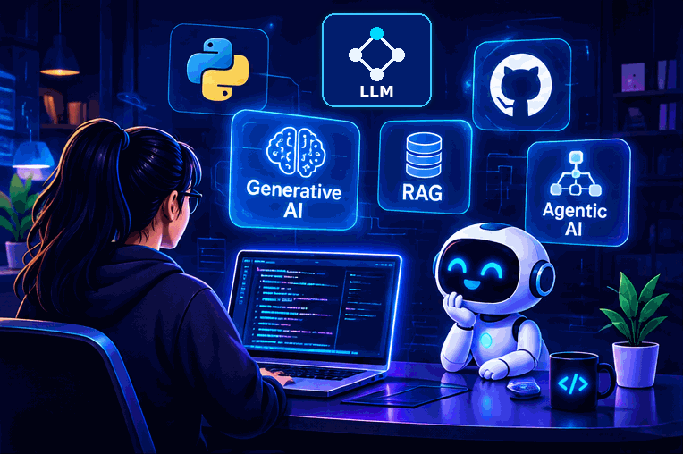
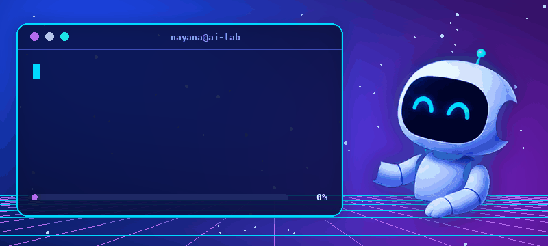
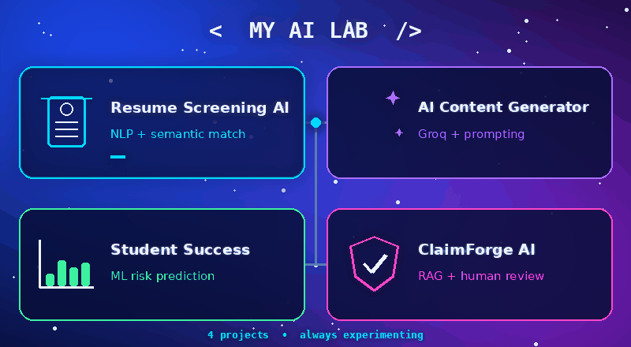

<h1 align="center">👋 Hi, I'm Nayana Tumma</h1>
<h3 align="center">🚀 Aspiring GenAI & Agentic AI Developer</h3>

---

<table>
<tr>
<td width="58%" valign="middle">

**👩‍💻 I build with GenAI, RAG and agents.**

Aspiring GenAI & Agentic AI Developer, turning ideas into practical AI apps.

`Python` `LLM` `RAG` `Agentic AI`

</td>
<td width="42%" align="center" valign="middle">

</td>
</tr>
</table>

## 🤖 About Me

<table>
<tr>
<td width="58%" valign="middle">

- 🎓 **M.Tech**, Computer Science
- 💼 **AI Intern**, WeIntern
- 🤖 Interested in Generative AI, LLMs and Agentic AI
- 🐍 Python and AI application development
- 🏅 Certified: Advanced Generative AI & Agentic AI
- 🚀 Building practical AI projects

</td>
<td width="42%" align="center" valign="middle">

</td>
</tr>
</table>

## 🌌 Tech Stack

<table>
<tr>
<td width="58%" valign="middle">

**Language** 
<code>Python</code>

**GenAI and agents** 
<code>LLM</code> <code>RAG</code> <code>LangChain</code> <code>LangGraph</code> <code>Groq</code> <code>ChromaDB</code>

**ML and apps** 
<code>Scikit-learn</code> <code>Pandas</code> <code>Plotly</code> <code>Streamlit</code>

**Tools** 

</td>
<td width="42%" align="center" valign="middle">

</td>
</tr>
</table>

## 🧪 Featured Projects

<table>
<tr>
<td width="58%" valign="middle">

**📄 Resume Screening AI** · [Live app](https://resume-screening-ai-8g7xzgkhckndkfznumxlah.streamlit.app/) 
Matches resumes to job descriptions using NLP and semantic similarity.

**✍️ AI Content Generator** · [Live app](https://ai-content-generator-kkwzg66gdmwsswxj4dsfs2.streamlit.app/) 
Generates and refines content with LLMs, Groq API and prompt engineering.

**🎓 Student Success Dashboard** 
Analyzes performance to identify students who may need support.

**🛡️ ClaimForge AI** · [Live app](https://claimforge-ai.streamlit.app/) 
Claims agent exploring RAG, document checks and human review.

</td>
<td width="42%" align="center" valign="middle">

</td>
</tr>
</table>

## 📊 GitHub Analytics

## 🤝 Connect With Me

<table>
<tr>
<td width="58%" valign="middle">

**Let's connect and build something with AI.**

</td>
<td width="42%" align="center" valign="middle">

</td>
</tr>
</table>
