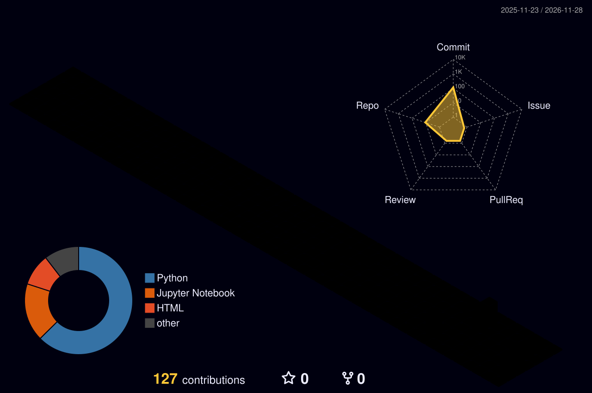

  

## 🤖 About Me

- 🎓 **M.Tech**, Computer Science
- 💼 **AI Intern**, WeIntern
- 🤖 Interested in Generative AI, LLMs and Agentic AI
- 🐍 Python and AI application development
- 🏅 Certified: Advanced Generative AI & Agentic AI
- 🚀 Building practical AI projects

 

## 🌌 Tech Stack

**Language** 

**GenAI and agents** 
     

**ML and apps** 
   

**Tools** 
  

 

## 🧪 Featured Projects

**📄 Resume Screening AI** · [Live app](https://resume-screening-ai-8g7xzgkhckndkfznumxlah.streamlit.app/) 
Matches resumes to job descriptions using NLP and semantic similarity.

**✍️ AI Content Generator** · [Live app](https://ai-content-generator-kkwzg66gdmwsswxj4dsfs2.streamlit.app/) 
Generates and refines content with LLMs, Groq API and prompt engineering.

**🎓 Student Success Dashboard** 
Analyzes performance to identify students who may need support.

**🛡️ ClaimForge AI** · [Live app](https://claimforge-ai.streamlit.app/) 
Claims agent exploring RAG, document checks and human review.

 

## 📈 GitHub Activity Graph

<picture>
<source media="(prefers-color-scheme: dark)" srcset="https://raw.githubusercontent.com/nayanatumma69-collab/nayanatumma69-collab/output/github-contribution-grid-snake-dark.svg" />

</picture>

## 📊 GitHub Stats

## 🤝 Connect With Me

**Let's connect and build something with AI.**

 

