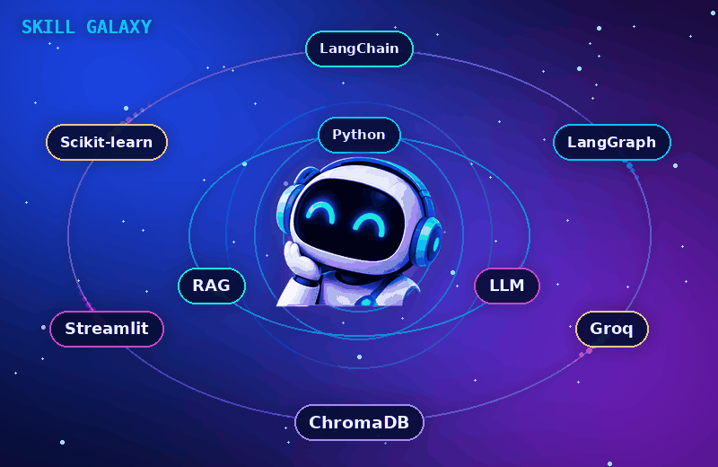
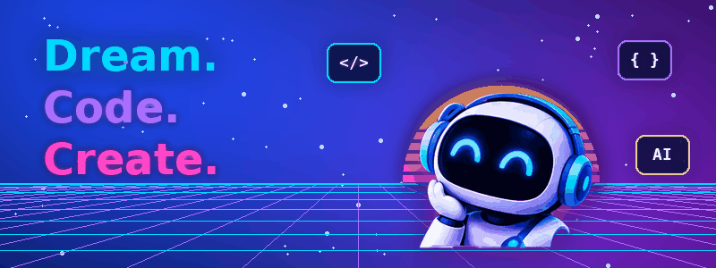

<h1 align="center">👋 Hi, I'm Nayana Tumma</h1>
<h3 align="center">🚀 Aspiring GenAI & Agentic AI Developer</h3>

  

  

---

## 🤖 Boot Sequence

  

---

## 🌌 Skill Galaxy

  

  

---

## 🧪 My AI Lab

  

<table>
  <tr>
    <td width="50%" valign="top">
      <h3>📄 Resume Screening AI</h3>
      
AI-powered resume analysis and job-description matching using NLP and semantic similarity.

      
<code>Python</code> <code>NLP</code> <code>Sentence Transformers</code> <code>Streamlit</code>

      
<a href="https://resume-screening-ai-8g7xzgkhckndkfznumxlah.streamlit.app/"><b>🚀 Live app</b></a>

    </td>
    <td width="50%" valign="top">
      <h3>✍️ AI Content Generator</h3>
      
Generates and refines content using LLMs, Groq API and prompt engineering.

      
<code>Python</code> <code>Groq API</code> <code>Generative AI</code> <code>Streamlit</code>

      
<a href="https://ai-content-generator-kkwzg66gdmwsswxj4dsfs2.streamlit.app/"><b>🚀 Live app</b></a>

    </td>
  </tr>
  <tr>
    <td width="50%" valign="top">
      <h3>🎓 Student Success & At-Risk Prediction</h3>
      
Machine-learning dashboard to analyze student performance and identify students who may need support.

      
<code>Python</code> <code>Pandas</code> <code>Scikit-learn</code> <code>Streamlit</code> <code>Plotly</code>

    </td>
    <td width="50%" valign="top">
      <h3>🛡️ ClaimForge AI</h3>
      
Insurance claims agent exploring RAG-based analysis, document verification and human-in-the-loop review.

      
<code>Python</code> <code>LangGraph</code> <code>LangChain</code> <code>Groq</code> <code>ChromaDB</code>

      
<a href="https://claimforge-ai.streamlit.app/"><b>🚀 Live app</b></a>

    </td>
  </tr>
</table>

---

## 💼 Experience & Education

- **AI Intern**, WeIntern
- **M.Tech**, Computer Science

## 🏅 Certifications

- Advanced Generative AI & Agentic AI

---

## 🤝 Connect With Me

  
  

  

